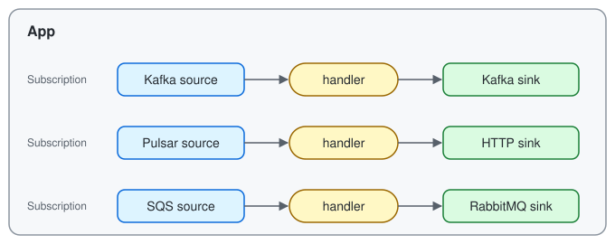

# beave-rs

[](https://crates.io/crates/beavers)
[](https://docs.rs/beavers)
[](https://github.com/cafeal/beave-rs/actions/workflows/ci.yml)
[](#license)

A lightweight Rust message processing framework built around typed handlers.

<p align="center">
  
</p>

Each `Subscription` connects one source, one handler, and one sink. An `App`
runs any number of subscriptions side by side and shuts them down together.

- **Typed handlers** — write `async fn(Input) -> Result<Output>`; decoding,
  publishing, and acknowledgement are handled for you.
- **At-least-once delivery** — an input is acknowledged only after its output
  is published.
- **Explicit failure handling** — classify errors as retry, reject
  (dead-letter), or fatal; retries back off.
- **Concurrency with ordering** — bounded concurrency, per-key ordering, and a
  worker pool for blocking handlers.
- **Pipelines** — chain subscriptions through in-process channels with
  end-to-end acknowledgement.
- **Adapters** — Kafka, Apache Pulsar, RabbitMQ, Amazon SQS, Google Cloud
  Pub/Sub, Azure Service Bus, and HTTP; JSON, Avro, Protobuf, MessagePack,
  and CBOR codecs, with Base64 and gzip or Zstandard compression wrappers.
- **Operations** — graceful shutdown, `tracing` spans, `metrics`,
  OpenTelemetry trace propagation, and `/livez` and `/readyz` probes.

> beave-rs is pre-release. The API may change until 0.1.0.

## Installation

```sh
cargo add beavers --features kafka
cargo add tokio --features macros,rt-multi-thread
cargo add anyhow
```

No Cargo feature is enabled by default. Enable the adapters and codecs the
application uses:

| Feature | Enables |
|---|---|
| `kafka` | Kafka source and sink |
| `pulsar` | Apache Pulsar source and sink |
| `rabbitmq` | RabbitMQ source and sink |
| `sqs` | Amazon SQS source and sink |
| `pubsub` | Google Cloud Pub/Sub source and sink |
| `servicebus` | Azure Service Bus source and sink |
| `http` | HTTP source and sink |
| `avro` | Avro codec |
| `protobuf` | Protobuf codec |
| `msgpack` | MessagePack codec |
| `cbor` | CBOR codec |
| `base64` | Base64 wrapper for another codec |
| `gzip` | Gzip compression wrapper for another codec |
| `zstd` | Zstandard compression wrapper for another codec |
| `opentelemetry` | Trace-context propagation through broker metadata |
| `health` | `/livez` and `/readyz` endpoints |
| `testing` | Fabricated broker records for handler tests |

## Quick start

Summarize each article on a Kafka topic with an LLM and publish the summaries
to another topic:

```rust
use beavers::{
    App, Classify, Result, Utf8,
    adapters::kafka::Kafka,
};

async fn summarize(article: String) -> Result<String> {
    let summary = call_llm(&format!("Summarize: {article}")).await.retry()?;
    Ok(summary)
}

#[tokio::main]
async fn main() -> anyhow::Result<()> {
    let kafka = Kafka::new("localhost:9092");
    let articles = kafka.source::<Utf8, _>("summarizer", ["articles"]);
    let summaries = kafka.sink::<Utf8, _>("summaries");

    App::new()
        .subscribe("summarize", articles, summaries, summarize)
        .run()
        .await?;
    Ok(())
}
```

The handler sees only the decoded value. A transient API failure is retried
with backoff, and each offset is committed after its summary is published.
Sources and sinks built from one `Kafka` handle share its connection settings,
and its sinks share one producer.

The repository's examples run against local brokers started with Docker
Compose, which also provides web consoles for Kafka and Pulsar:

```sh
docker compose up -d --wait
cargo kafka-produce
cargo kafka-process   # Ctrl-C to stop
docker compose down
```

To try the API without a broker, run `cargo run --example transform`. See
[local development brokers](docs/development.md) for every example, console,
and Cargo alias.

## Errors

Errors propagated with `?` reject the input, which is dead-lettered by default.
The handler asks for other outcomes at the call site:

```rust
async fn handle(order: Order) -> Result<Output> {
    validate(&order).reject()?; // dead-letter now (same as `?`)
    let user = db.find_user(order.user_id).await.retry()?; // retry, then dead-letter
    Ok(build_output(order, user))
}
```

`.fatal()?` stops the subscription. See
[errors and retries](docs/runtime/errors.md) for retry policies
and the error policy.

## Documentation

- [Documentation index](docs/README.md)
- [Architecture and trait contracts](docs/architecture.md)
- [Adapters and usage examples](docs/adapters.md)
- [Codecs and serialization](docs/codecs.md)
- [Dead-letter handling](docs/dead-letter-handling.md)
- [Monitoring and alerting](docs/monitoring-and-alerting/README.md)
- [Testing handlers](docs/testing.md)
- [Runtime behavior, configuration, and limitations](docs/runtime.md)
- [Design plan and roadmap](docs/plan.md)
- [Local development brokers](docs/development.md)
- [Versioning and releases](docs/releasing.md)
- [API reference on docs.rs](https://docs.rs/beavers)

The guides are also published at <https://cafeal.github.io/beave-rs/>. Each
page's Markdown source is available at the page URL with `.html` replaced by
`.md`, and [`llms.txt`](https://cafeal.github.io/beave-rs/llms.txt) lists them
all for language-model tools.

## Development

The minimum supported Rust version is 1.94.1. See
[local development brokers](docs/development.md) for the local Kafka, Pulsar,
RabbitMQ, SQS, Pub/Sub, and Azure Service Bus environment and the live tests, and
[AGENTS.md](AGENTS.md) for the checks every change must pass.

## License

Licensed under the [MIT license](LICENSE-MIT).

**Let application code process events. Let beave-rs manage the flow.**
